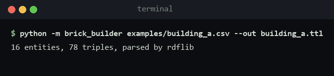

# brick-model-builder

[](https://github.com/yassine2med/brick-model-builder/actions/workflows/ci.yml)  

Building automation points and equipment usually live in spreadsheets, and every analytics or fault-detection project starts by rebuilding that list in a common vocabulary. Brick Schema is an open vocabulary for describing equipment, spaces and sensors and how they connect. This tool reads a plain equipment spreadsheet, checks it, and writes a Brick model in Turtle, so the same sheet a facility team already keeps can feed any Brick-aware tool.

The example is an invented "Building A" with two floors, one air handler, three VAV boxes, a chiller, a pump and a few sensors.



## What it is for

Every analytics or fault-detection project on a building starts by rebuilding the equipment list in a common vocabulary. Facility data coordinators, controls engineers and energy analysts use this tool to turn the equipment spreadsheet they already keep into a Brick model. They get a checked Turtle file that Brick-aware tools can read, or a list of every problem in the sheet if it is wrong.

## Install

```
git clone <this repo>
cd brick-model-builder
pip install -r requirements.txt pytest
```

Python 3.10 or newer. Depends on rdflib (used to parse the output as a syntax check).

## How to use

| I want to | Command |
|---|---|
| Write a Brick model to a file | `PYTHONPATH=src python -m brick_builder examples/building_a.csv --out building_a.ttl` |
| Print the Turtle to standard output | `PYTHONPATH=src python -m brick_builder examples/building_a.csv` |
| Show help | `PYTHONPATH=src python -m brick_builder --help` |

On Windows PowerShell set `$env:PYTHONPATH = "src"` first. A bad sheet exits with code 1 and lists every problem, for example `line 3: unknown type 'Spaceship' for a` or `ahu_1: feeds refers to unknown id vav_9`.

Sheet columns: `id, label, type, part_of, location, feeds, point_of`. `feeds` takes several ids separated by semicolons. Supported types are listed in `CLASS_MAP` in `src/brick_builder/core.py` (building, floor, room, HVAC zone, AHU, VAV, chiller, boiler, pump, fan, and three point types).

Example:

```
PYTHONPATH=src python -m brick_builder examples/building_a.csv --out building_a.ttl
```

Output:

```

```

The first lines of `building_a.ttl`:

```
@prefix brick: <https://brickschema.org/schema/Brick#> .
@prefix bldg: <https://example.org/building#> .
@prefix rdfs: <http://www.w3.org/2000/01/rdf-schema#> .

bldg:bldg_a a brick:Building ; rdfs:label "Building A" .
bldg:floor_1 a brick:Floor ; rdfs:label "Floor 1" .
bldg:floor_2 a brick:Floor ; rdfs:label "Floor 2" .
bldg:room_101 a brick:Room ; rdfs:label "Room 101" .
bldg:room_102 a brick:Room ; rdfs:label "Room 102" .
bldg:room_201 a brick:Room ; rdfs:label "Room 201" .
bldg:ahu_1 a brick:Air_Handling_Unit ; rdfs:label "AHU-1" .
```

## How it works

1. Each row's `type` is looked up in a fixed table of spreadsheet labels and Brick classes.
2. The sheet is checked as a whole: bad ids, unknown types, duplicate ids, links to ids that do not exist and links to self. All problems are reported together.
3. Each entity becomes a typed node with an `rdfs:label`.
4. `part_of`, `location`, `feeds` and `point_of` become `isPartOf`, `hasLocation`, `feeds` and `hasPoint`, and the inverse (`hasPart`, `isLocationOf`, `isFedBy`, `isPointOf`) is written too.
5. The Turtle is parsed with rdflib and the triple count is reported.

## Limits

- Thirteen classes only. Add rows to `CLASS_MAP` for more.
- The output is checked for valid Turtle, not against the Brick ontology, so a relationship Brick does not allow between two classes is not caught.
- The namespace `https://example.org/building#` is a placeholder; change `BASE` for real use.

## License

MIT, see LICENSE. Author: Yassine Emhamed.
